<div align="center">

# ✨ Antigravity Custom Theme Engine (v7 MVVM)


</div>

<details name="ag-readme-lang">
<summary>🌐 <b>Language / Ngôn ngữ:</b> &nbsp;<kbd>🇻🇳 Tiếng Việt</kbd> &nbsp;<sub>(Bấm vào đây để đổi sang Tiếng Việt ngay tại trang này ▾)</sub></summary>

<br />

> 🌐 Đang hiển thị: **🇻🇳 Tiếng Việt** &nbsp;•&nbsp; Đổi lại ngôn ngữ: [**🇺🇸 English**](?lang=en#readme)

<p align="center">
  <b>Bộ giao diện Chibi chuyển động toàn diện dành cho Google Antigravity Desktop Client</b><br /><br />
  
  
  
  
  <br /><br />
  👉 <a href="https://datnguyen0909.github.io/antigravity-custom-theme/?lang=vi"><b>Mở bản Xem Trước Tương Tác Trực Tiếp (GitHub Pages — Tiếng Việt)</b></a><br />
  <i>(Thử gõ chat, rê chuột, bật chế độ Theo Mùa, đổi Dark/Light &amp; Anh/Việt cho cả 18 chủ đề ngay trên trình duyệt!)</i>
</p>

---

## 🌟 Tính năng nổi bật

- **🎭 Hệ thống chuyển động 4 tầng cho mỗi linh vật (54 file SVG thuần CSS, siêu nhẹ)**:
  1. **Tĩnh + Diễn cảnh tự động mỗi 15 giây (`idle.svg`)**: Đứng nhịp nhàng trên bong bóng chat; cứ mỗi 15 giây tự diễn một tình huống hài hước riêng (Bí ngô Halloween bật nắp đầu cho bé ma con "BOO!" tung kẹo, Mèo Code gặp `ERROR` đập laptop, Hiệp sĩ mở rương ra `+1 EXP` thất vọng, Cá voi phun cầu vồng...).
  2. **Hành động đặc trưng khi bạn đang gõ (`typing.svg`)**: Khi nhập tin nhắn, mỗi linh vật diễn đúng bản chất riêng (Bí ngô khuấy kẹo bằng kẹo mút phép thuật, Cá mập mài răng, Mèo than vờn cuộn len, Thỏ giã bánh Mochi, Hiệp sĩ rèn kiếm trên đe...) kèm hạt hiệu ứng theo từng phím và bong bóng suy nghĩ khi dừng tay 1,5 giây.
  3. **Hoạt cảnh sân khấu ngang khi rê chuột (`action.svg`)**: Rê chuột vào bong bóng chat hoặc ô nhập sẽ mở ra cả một sân khấu ngang có bối cảnh đi kèm (nghĩa địa trăng máu Halloween, cổng Torii, cọc Mai Hoa Thung, ống nước & gạch `?`, đảo nổi hoàng hôn...).
  4. **🗓️ Tự động đổi Linh vật theo Mùa / Lễ hội & Song ngữ Anh/Việt**: Công tắc **Auto-Season** tự động diện đúng chủ đề theo lịch năm (Tết 🦁 • Xuân 🌸 • Hè 🦈 • Thu 🦊 • Halloween 🎃 • Đông ❄️ • Noel ⛄), hỗ trợ hộp chọn ngôn ngữ **EN / VI**, **Dark / Light**, chỉnh độ tối nền, ảnh nền cá nhân và lưu cứng trên ổ đĩa.

---

## 🖼️ Bộ sưu tập 18 Chủ đề (Xem trực tiếp)

> 💡 Các ảnh bên dưới là **SVG chuyển động trực tiếp** từ thư mục `stickers/` — nếu đợi đủ nhịp 15s bạn sẽ thấy từng bé tự diễn trò ngay trong bảng này!

| # | Chủ đề | Tĩnh + Tự diễn mỗi 15s | Khi bạn đang gõ | Hoạt cảnh sân khấu khi rê chuột |
|:-:|:---|:---:|:---:|:---:|
| 1 | **🐉 Rồng ngọc**<br/>`jade-dragon` | <br/><sub>Hắt xì lửa ngọc</sub> | <br/><sub>Uốn lượn vờn minh châu</sub> | <br/><sub>Bay lượn xuyên mây lớn & mây nhỏ</sub> |
| 2 | **🔥 Phượng hoàng lửa**<br/>`fire-phoenix` | <br/><sub>Ấp trứng nở gà con</sub> | <br/><sub>Vỗ cánh vẽ cổ ngữ lửa</sub> | <br/><sub>Sải cánh bay qua mây lửa & thái dương</sub> |
| 3 | **🚀 Phi hành gia**<br/>`space-astronaut` | <br/><sub>UFO hút Sao Thổ</sub> | <br/><sub>Tung hứng hành tinh</sub> | <br/><sub>Bật Jetpack bay quanh các hành tinh</sub> |
| 4 | **🦉 Cú cổ thư**<br/>`wise-owl` | <br/><sub>Ngủ gật nổ bóng mũi</sub> | <br/><sub>Viết bút lông lên cổ thư</sub> | <br/><sub>Bay đưa mật thư qua đỉnh núi cổ phong</sub> |
| 5 | **🌙 Phù thủy ánh trăng**<br/>`moon-witch` | <br/><sub>Phép lỗi hóa ếch xanh</sub> | <br/><sub>Khuấy vạc phép thuật</sub> | <br/><sub>Cưỡi chổi bay qua trăng khuyết & tháp cổ</sub> |
| 6 | **🦊 Hồ ly chibi**<br/>`fox-chibi` | <br/><sub>Hóa đậu phụ thành lá</sub> | <br/><sub>Xoay cầu lửa hồ ly</sub> | <br/><sub>Phóng qua cổng Torii & đèn lồng</sub> |
| 7 | **🌸 Thỏ ngọc anh đào**<br/>`sakura-bunny` | <br/><sub>Ăn bánh Dango bắn tim</sub> | <br/><sub>Cầm chày giã bánh Mochi</sub> | <br/><sub>Nhảy lò cò qua rừng hoa anh đào</sub> |
| 8 | **🦈 Cá mập đại dương**<br/>`ocean-shark` | <br/><sub>Thổi bóng vịt vàng</sub> | <br/><sub>Cầm giũa mài hàm răng</sub> | <br/><sub>Vây cá rẽ sóng rồi phóng vọt lên</sub> |
| 9 | **♟ Chốt gangster**<br/>`gangster-pawn` | <br/><sub>Quẹt xì gà hỏng quăng đi</sub> | <br/><sub>Tung xu vàng & quạt đô la</sub> | <br/><sub>Xe cầm chùy tới → Chốt hóa Hậu rút súng</sub> |
| 10 | **❄️ Cánh cụt băng tuyết**<br/>`ice-penguin` | <br/><sub>Ăn kem đóng băng não</sub> | <br/><sub>Tung hứng 3 chú cá bạc</sub> | <br/><sub>Trượt bụng & nhảy qua tảng băng nổi</sub> |
| 11 | **🤖 Robot AI tối giản**<br/>`ai-robot` | <br/><sub>Lỗi 404 tự vỗ đầu sửa</sub> | <br/><sub>Gõ bàn phím Hologram</sub> | <br/><sub>Lướt ván từ trường qua cổng Hologram</sub> |
| 12 | **🐾 Mèo than**<br/>`black-cat` | <br/><sub>Đuổi vồ chấm đèn Laser</sub> | <br/><sub>Vờn cuộn len đỏ bung sợi</sub> | <br/><sub>Nhảy trên mái nhà đêm trăng</sub> |
| 13 | **⛄ Người tuyết Noel**<br/>`noel-snowman` | <br/><sub>Mở quà hóa sừng tuần lộc</sub> | <br/><sub>Viết điều ước bằng kẹo gậy</sub> | <br/><sub>Cưỡi xe tuần lộc phát quà rừng thông</sub> |
| 14 | **🦁 Kỳ Lân Múa Tết**<br/>`tet-lion` | <br/><sub>Nhả liễn Lộc & nổ pháo</sub> | <br/><sub>Múa đầu theo nhịp trống</sub> | <br/><sub>Nhảy cọc Mai Hoa Thung hái Lộc</sub> |
| 15 | **🐱‍💻 Mèo Code dạo**<br/>`code-cat` | <br/><sub>ERROR đập laptop lấy máy mới</sub> | <br/><sub>Gõ code cuộn màn hình</sub> | <br/><sub>Cưỡi con trỏ chuột đi vợt bug</sub> |
| 16 | **🗡️ Pixel Hiệp Sĩ 8-bit**<br/>`pixel-knight` | <br/><sub>Mở rương ra +1 EXP xịu mặt</sub> | <br/><sub>Đập búa rèn kiếm nung đỏ</sub> | <br/><sub>Nhảy qua ống nước & cụng gạch rơi xu</sub> |
| 17 | **🐋 Cá Voi Mây**<br/>`cloud-whale` | <br/><sub>Phun cầu vồng & chim én đậu</sub> | <br/><sub>Hát nốt nhạc & bong bóng mây</sub> | <br/><sub>Bơi giữa đảo nổi hoàng hôn tạo mây</sub> |
| 18 | **🎃 Bí Ngô Ma Trơi**<br/>`halloween-pumpkin` | <br/><sub>Mở nắp đầu ma con BOO! thả kẹo</sub> | <br/><sub>Khuấy vạc kẹo bằng kẹo mút phép</sub> | <br/><sub>Cưỡi chổi bay qua nghĩa địa trăng máu</sub> |

---

## 🚀 Hướng dẫn Cài đặt & Sử dụng (Windows — 1 Click)

> **Không cần cài đặt Node.js hay `npm install`!** Bộ cài tự động tận dụng nhân Electron có sẵn của Antigravity.

### 1. Cài đặt (Install)
1. Clone hoặc tải ZIP dự án này về máy:
   ```bash
   git clone https://github.com/DatNguyen0909/antigravity-custom-theme.git
   ```
2. Đóng ứng dụng **Antigravity** (hoặc cài xong rồi Reload cũng được).
3. Nhấp đúp chạy file **`install.bat`**.
   - Script sẽ tự động tạo bản sao lưu gốc `app.asar.bak` an toàn tại `%LOCALAPPDATA%\Programs\antigravity\resources\`, biên dịch `clean_bundle.js` và đóng gói vào `app.asar`.
4. Mở lại **Antigravity** (hoặc nhấn `Ctrl + Shift + P` → `Developer: Reload Window`).
5. Vào **Settings (⚙️) → Custom theme** (nằm ngay dưới mục `Appearance`) để chọn linh vật, đổi ngôn ngữ **Tiếng Việt / English**, chỉnh độ tối nền hoặc tải ảnh nền riêng!

### 2. Khi Antigravity tự động Update lên phiên bản mới
Mỗi khi Antigravity cập nhật phiên bản mới, bộ cài của hãng sẽ ghi đè lại `app.asar` gốc. Bạn chỉ cần **nhấp đúp lại `install.bat`** (mất ~2 giây, mọi cấu hình chủ đề bạn đã chọn trước đó vẫn được giữ nguyên 100%).

### 3. Gỡ cài đặt về mặc định (Uninstall)
- Cách nhanh trong ứng dụng: Vào **Settings → Custom theme** và gạt công tắc **OFF** để về giao diện mặc định ngay lập tức mà không cần khởi động lại.
- Gỡ hoàn toàn khỏi `app.asar`: Nhấp đúp chạy file **`uninstall.bat`** để khôi phục bản `app.asar.bak` nguyên bản.

---

## 🏗️ Cấu trúc dự án (Kiến trúc MVVM)

```text
antigravity-custom-theme/
├── index.html                      # Trang Web xem trước tương tác trực tiếp (EN / VI)
├── README.md                       # Tài liệu song ngữ tích hợp (English / Tiếng Việt)
├── stickers/                       # 18 thư mục linh vật, mỗi thư mục gồm 3 trạng thái SVG
│   ├── jade-dragon/                # idle.svg | action.svg | typing.svg
│   ├── halloween-pumpkin/          # idle.svg | action.svg | typing.svg
│   ├── cloud-whale/                # idle.svg | action.svg | typing.svg
│   └── ... (18 thư mục chủ đề)
├── src/
│   ├── models/                     # [MODEL] Dữ liệu thuần (Single Source of Truth - VI & EN)
│   │   ├── themes.js               # Khai báo 18 chủ đề & lịch Auto-Season (màu, tên Anh/Việt, FX)
│   │   ├── backgrounds.js          # Bảng màu nền & Sidebar kính mờ (Dark / Light)
│   │   └── decor.js                # Họa tiết nền SVG & cấu hình hạt bay DECOR
│   ├── services/                   # [SERVICE] Lưu trữ & môi trường
│   │   ├── storageService.js       # Đồng bộ localStorage + Electron storage.json trên ổ đĩa
│   │   └── environmentService.js   # Nhận diện Light/Dark mode, lọc portal/tooltip, reset SVG
│   ├── viewmodels/                 # [VIEWMODEL] State & điều phối logic phản ứng
│   │   └── themeViewModel.js       # Quản lý config, ngôn ngữ EN/VI, trạng thái gõ phím
│   ├── views/                      # [VIEW] Giao diện DOM & CSS tách biệt
│   │   ├── styles/
│   │   │   ├── base.css            # Nền, overlay, sidebar, editor, bong bóng chat, ô nhập
│   │   │   ├── mascots.css         # Animation idle, hover stage & hiệu ứng gõ của 17 linh vật
│   │   │   └── settings.css        # Giao diện bảng Settings Custom Theme
│   │   ├── backgroundView.js       # Render #ag-custom-bg, #ag-custom-overlay, #ag-custom-decor
│   │   ├── chatView.js             # Render bong bóng chat, ô nhập, sticker, hạt gõ phím
│   │   └── settingsView.js         # Hook tab Custom theme & bảng chọn chủ đề song ngữ
│   └── app.js                      # Điểm khởi chạy (MVVM subscription, MutationObserver, tick)
├── build_bundle.js                 # Trình đóng gói tự động src/ + stickers/ -> clean_bundle.js
├── repack_asar.js                  # Đóng gói an toàn vào %LOCALAPPDATA%\Programs\antigravity\resources\app.asar
├── install.bat                     # Chạy 1 click để build & cài đặt theme
└── uninstall.bat                   # Khôi phục app.asar gốc từ app.asar.bak
```

---

## 🛠️ Cách tự thêm một Chủ đề mới (Chỉ 3 bước)

1. Tạo thư mục mới `stickers/<ten-chu-de>/` gồm 3 file: `idle.svg` (`120×120`), `typing.svg` (`120×120`) và `action.svg` (`260×95`).
2. Thêm cấu hình màu & hiệu ứng của `<ten-chu-de>` vào `src/models/themes.js`, `src/models/backgrounds.js`, `src/models/decor.js` và animation vào `src/views/styles/mascots.css`.
3. Chạy `install.bat` — trình đóng gói sẽ tự động nhận diện thư mục mới và nạp vào Antigravity!

---

## 📄 Giấy phép (License)

Phát hành theo giấy phép **MIT License** — tự do sử dụng, tùy biến và đóng góp thêm linh vật mới!

</details>

<details name="ag-readme-lang" open>
<summary>🌐 <b>Language / Ngôn ngữ:</b> &nbsp;<kbd>🇺🇸 English ✓</kbd> &nbsp;<sub>(Default — Click Tiếng Việt above to switch in-place ▴)</sub></summary>

<br />

<p align="center">
  <b>Animated Chibi Mascot &amp; Glassmorphism UI Theme Engine for Google Antigravity Desktop Client</b><br /><br />
  
  
  
  
  <br /><br />
  👉 <a href="https://datnguyen0909.github.io/antigravity-custom-theme/?lang=en"><b>Launch Live Interactive Web Preview (GitHub Pages)</b></a><br />
  <i>(Try typing in the chat box, hovering bubbles, toggling Auto-Season, Dark/Light &amp; EN/VI across all 18 themes right in your browser!)</i>
</p>

---

## 🌟 Key Features

- **🎭 4-Tier Interactive Mascot System (54 pure CSS-animated SVGs, ultra-lightweight)**:
  1. **Idle + 15-Second Auto-Skits (`idle.svg`)**: Mascots perch atop your chat bubbles and perform a funny character skit every 15 seconds (Halloween Pumpkin pops its witch hat so a baby ghost shouts `BOO!` with candy, Code Cat hits `ERROR` and smashes its laptop, Pixel Knight opens a chest for `+1 EXP`, Cloud Whale spouts a rainbow...).
  2. **Character-Specific Typing Reactions (`typing.svg`)**: While you type a prompt, your mascot switches to an authentic activity pose (Pumpkin stirs a candy cauldron with a giant lollipop wand, Shark files its teeth, Midnight Cat bats red yarn, Bunny pounds Mochi, Knight hammers a glowing blade...) with per-keystroke particles and a thinking bubble when you pause for 1.5s.
  3. **Panoramic Hover Stage (`action.svg`)**: Hovering over any user chat bubble or the prompt input unveils a full wide-screen animated stage (Haunted Blood-Moon Graveyard, Torii gates, plum-blossom poles, retro pipes & `?` blocks, sunset floating islands...).
  4. **🗓️ Auto-Season / Holiday Switcher & Bilingual UI**: Optional **Auto-Season** toggle automatically switches mascots throughout the year (Lunar New Year 🦁 • Spring 🌸 • Summer 🦈 • Autumn 🦊 • Halloween 🎃 • Winter ❄️ • Christmas ⛄), alongside a built-in **English / Tiếng Việt** selector, **Dark & Light** glassmorphism, dimming slider, custom wallpaper upload, and persistent disk storage.

---

## 🖼️ 18 Animated Theme Showcase (Live SVG)

> 💡 Every image below is a **live animated SVG** rendered directly from `stickers/` — watch for 15 seconds to see each mascot perform its mini-skit right inside this table!

| # | Theme | Idle + 15s Auto-Skit | While Typing | Panoramic Hover Stage |
|:-:|:---|:---:|:---:|:---:|
| 1 | **🐉 Jade Dragon**<br/>`jade-dragon` | <br/><sub>Sneezes emerald fire</sub> | <br/><sub>Swirls mystic pearl in clouds</sub> | <br/><sub>Soars through drifting jade clouds</sub> |
| 2 | **🔥 Fire Phoenix**<br/>`fire-phoenix` | <br/><sub>Hatches a tiny chick</sub> | <br/><sub>Draws glowing fire runes</sub> | <br/><sub>Glides across blazing clouds & sun</sub> |
| 3 | **🚀 Galaxy Astronaut**<br/>`space-astronaut` | <br/><sub>UFO beams up mini Saturn</sub> | <br/><sub>Juggles orbiting planets</sub> | <br/><sub>Jetpack flight around planets</sub> |
| 4 | **🦉 Ancient Scroll Owl**<br/>`wise-owl` | <br/><sub>Dozes off & pops sleep bubble</sub> | <br/><sub>Writes calligraphy with feather quill</sub> | <br/><sub>Delivers scrolls over misty peaks</sub> |
| 5 | **🌙 Moonlight Witch**<br/>`moon-witch` | <br/><sub>Spell backfires into green frog</sub> | <br/><sub>Stirs glowing magic cauldron</sub> | <br/><sub>Broomstick flight past crescent moon</sub> |
| 6 | **🦊 Chibi Kitsune**<br/>`fox-chibi` | <br/><sub>Transforms tofu into leaf</sub> | <br/><sub>Spins mystical foxfire orbs</sub> | <br/><sub>Dashes through Torii gates & lanterns</sub> |
| 7 | **🌸 Sakura Mochi Bunny**<br/>`sakura-bunny` | <br/><sub>Munches Dango & bursts hearts</sub> | <br/><sub>Pounds Mochi with wooden mallet</sub> | <br/><sub>Hops through cherry blossom woods</sub> |
| 8 | **🦈 Ocean Shark**<br/>`ocean-shark` | <br/><sub>Blows rubber ducky bubble</sub> | <br/><sub>Files its sharp teeth</sub> | <br/><sub>Slices waves & breaches high</sub> |
| 9 | **♟ Gangster Pawn**<br/>`gangster-pawn` | <br/><sub>Cigar misfires & tosses away</sub> | <br/><sub>Flips gold coin & fans dollar bills</sub> | <br/><sub>Rook charges → Promotes to Queen</sub> |
| 10 | **❄️ Glacier Penguin**<br/>`ice-penguin` | <br/><sub>Ice cream brain-freeze</sub> | <br/><sub>Juggles 3 silver fish</sub> | <br/><sub>Belly-slides across Arctic icebergs</sub> |
| 11 | **🤖 Minimalist AI Bot**<br/>`ai-robot` | <br/><sub>404 glitch & self-taps head</sub> | <br/><sub>Types on hologram keyboard</sub> | <br/><sub>Hoverboards through hologram gates</sub> |
| 12 | **🐾 Midnight Cat**<br/>`black-cat` | <br/><sub>Pounces on red laser dot</sub> | <br/><sub>Bats unraveling red yarn ball</sub> | <br/><sub>Leaps across moonlit rooftops</sub> |
| 13 | **⛄ Christmas Snowman**<br/>`noel-snowman` | <br/><sub>Unboxes reindeer antlers</sub> | <br/><sub>Writes wish list with candy cane</sub> | <br/><sub>Rides reindeer sleigh over pines</sub> |
| 14 | **🦁 Lunar New Year Lion**<br/>`tet-lion` | <br/><sub>Unfurls lucky scroll & firecrackers</sub> | <br/><sub>Dances to festive drumbeats</sub> | <br/><sub>Leaps plum-blossom poles</sub> |
| 15 | **🐱‍💻 Hacker Code Cat**<br/>`code-cat` | <br/><sub>ERROR → smashes laptop & grabs new</sub> | <br/><sub>Codes furiously on glowing screen</sub> | <br/><sub>Surfs mouse cursor catching bugs</sub> |
| 16 | **🗡️ 8-Bit Pixel Knight**<br/>`pixel-knight` | <br/><sub>Opens chest to tiny +1 EXP</sub> | <br/><sub>Forges glowing sword on anvil</sub> | <br/><sub>Jumps pipes & hits coin blocks</sub> |
| 17 | **🐋 Sunset Cloud Whale**<br/>`cloud-whale` | <br/><sub>Spouts rainbow & swallow perches</sub> | <br/><sub>Sings notes & cloud bubbles</sub> | <br/><sub>Swims past sunset floating islands</sub> |
| 18 | **🎃 Halloween Pumpkin**<br/>`halloween-pumpkin` | <br/><sub>Ghost pops out shouting BOO!</sub> | <br/><sub>Stirs candy pot with lollipop wand</sub> | <br/><sub>Broomstick flight over blood-moon crypt</sub> |

---

## 🚀 1-Click Installation & Usage (Windows)

> **Zero external dependencies!** No Node.js or `npm install` required — the installer automatically runs using Antigravity's built-in Electron binary.

### 1. Install
1. Clone or download this repository as a ZIP:
   ```bash
   git clone https://github.com/DatNguyen0909/antigravity-custom-theme.git
   ```
2. Close **Antigravity** (or reload the window after installing).
3. Double-click **`install.bat`**.
   - Automatically creates a safe backup (`app.asar.bak`) inside `%LOCALAPPDATA%\Programs\antigravity\resources\`, builds `clean_bundle.js`, and patches `app.asar` with verified 4-byte header alignment and SHA-256 integrity recalculation.
4. Launch **Antigravity** (or press `Ctrl + Shift + P` → `Developer: Reload Window`).
5. Open **Settings (⚙️) → Custom theme** (right below `Appearance`) to choose your mascot, switch **English / Tiếng Việt**, adjust background dimming, or set a custom wallpaper!

### 2. After Antigravity Auto-Updates
Whenever Antigravity updates to a newer version, its updater replaces `app.asar`. Simply **double-click `install.bat` again** (~2 seconds) — all your saved theme preferences remain 100% intact.

### 3. Uninstall / Restore Default
- **Instant in-app toggle**: Open **Settings → Custom theme** and switch **OFF** to immediately revert to the native interface without restarting.
- **Full unpatch**: Double-click **`uninstall.bat`** to restore the original `app.asar.bak`.

---

## 🏗️ Project Architecture (MVVM)

```text
antigravity-custom-theme/
├── index.html                      # Interactive Live Web Simulator & Gallery (EN / VI)
├── README.md                       # In-place Bilingual Documentation (English & Tiếng Việt)
├── stickers/                       # 18 mascot folders, 3 animated SVG states each
│   ├── jade-dragon/                # idle.svg | action.svg | typing.svg
│   ├── halloween-pumpkin/          # idle.svg | action.svg | typing.svg
│   ├── cloud-whale/                # idle.svg | action.svg | typing.svg
│   └── ... (18 theme folders)
├── src/
│   ├── models/                     # [MODEL] Single Source of Truth (EN & VI metadata)
│   │   ├── themes.js               # 18 theme definitions + Auto-Season calendar
│   │   ├── backgrounds.js          # Dark & Light gradients + frosted sidebar palettes
│   │   └── decor.js                # Background SVG scenery & ambient particle configs
│   ├── services/                   # [SERVICE] Persistence & runtime environment
│   │   ├── storageService.js       # Syncs localStorage + Electron disk storage.json
│   │   └── environmentService.js   # Light/Dark detection, portal filtering, SVG reset
│   ├── viewmodels/                 # [VIEWMODEL] Reactive state & user commands
│   │   └── themeViewModel.js       # State store, EN/VI language state, typing timers
│   ├── views/                      # [VIEW] Decoupled DOM renderers & stylesheets
│   │   ├── styles/
│   │   │   ├── base.css            # Background, overlay, sidebar, bubbles, composer
│   │   │   ├── mascots.css         # Keyframe animations for all 17 mascots
│   │   │   └── settings.css        # Settings -> Custom Theme modal UI
│   │   ├── backgroundView.js       # Renders #ag-custom-bg, #ag-custom-overlay, #ag-custom-decor
│   │   ├── chatView.js             # Renders chat bubbles, input stickers, typing particles
│   │   └── settingsView.js         # Hooks Custom theme tab & bilingual picker overlay
│   └── app.js                      # Bootstrapper (MVVM subscriptions, observers, tick)
├── build_bundle.js                 # Auto-discovers stickers/ + compiles src/ -> clean_bundle.js
├── repack_asar.js                  # Safe ASAR patcher with alignment & integrity verification
├── install.bat                     # 1-click build & install script
└── uninstall.bat                   # 1-click restore from app.asar.bak
```

---

## 🛠️ How to Add a New Theme (3 Easy Steps)

1. Create `stickers/<theme-id>/` containing `idle.svg` (`120×120`), `typing.svg` (`120×120`), and `action.svg` (`260×95`).
2. Add `<theme-id>` entries to `src/models/themes.js`, `src/models/backgrounds.js`, `src/models/decor.js`, and its CSS rules in `src/views/styles/mascots.css`.
3. Run `install.bat` — the bundler automatically embeds the new folder and deploys it into Antigravity!

---

## 📄 License

Released under the **MIT License** — free to use, customize, and contribute new mascots!

</details>
