<div align="center">

# ✨ Antigravity Custom Theme Engine (v7 MVVM)


</div>

<details name="ag-readme-lang">
<summary>🌐 <b>Language / Ngôn ngữ:</b> &nbsp;<kbd>🇻🇳 Tiếng Việt</kbd> &nbsp;<sub>(Bấm vào đây để đổi sang Tiếng Việt ngay tại trang này ▾)</sub></summary>

<br />

> 🌐 Đang hiển thị: **🇻🇳 Tiếng Việt** &nbsp;•&nbsp; Đổi lại ngôn ngữ: [**🇺🇸 English**](?lang=en#readme)

<p align="center">
  <b>Bộ giao diện Chibi chuyển động toàn diện dành cho Google Antigravity Desktop Client</b><br /><br />
  
  
  
  
  
  <br /><br />
  👉 <a href="https://datnguyen0909.github.io/antigravity-custom-theme/?lang=vi"><b>Mở bản Xem Trước Tương Tác &amp; Nghe Nhạc Trực Tiếp (GitHub Pages — Tiếng Việt)</b></a><br />
  <i>(Bật thử 🎶 Nhạc nền Studio, gõ chat nghe tiếng phím riêng, rê chuột, bật chế độ Theo Mùa &amp; đổi Dark/Light ngay trên trình duyệt!)</i>
</p>

---

## 🌟 Tính năng nổi bật

1. **🎭 Linh vật động theo từng chủ đề (21 mẫu — 105 file SVG siêu nhẹ)**:
   - Mỗi linh vật có **5 trạng thái SVG riêng biệt**: **Tự diễn mỗi 15s**, **Phản ứng khi bạn gõ phím**, **Sân khấu ngang khi rê chuột**, và bộ đôi **SVG phản ứng trạng thái AI (`AI Suy nghĩ` & `AI Hoàn thành`)**.
2. **🎧 Nhạc nền, Tiếng gõ phím & Chuông báo AI sống động (`0 KB MP3`)**:
   - Mô phỏng nhạc cụ thực tế (Piano, Guitar, Đàn Tranh, Đàn Hạc, Sáo Trúc, Contrabass) cùng Chiptune 8-bit / Synthwave; kèm **🔔 Chuông báo tinh tế khi AI xong việc (`AI Done Chime`)**.
   - Có công tắc bật/tắt độc lập cho **🎹 Tiếng phím**, **🎶 Nhạc nền**, **🔔 Chuông báo AI**, nút nghe thử và thanh chỉnh âm lượng.
3. **🗓️ Đồng bộ tự động theo Mùa & Lễ hội (`Seasonal & Holiday Sync`)**:
   - Tự động chuyển đổi linh vật theo 4 mùa và các dịp lễ lớn trong năm (Tết, Valentine, Hè, Trung Thu, Halloween, Noel...) kèm thẻ nổi bật hiển thị **Chủ đề hôm nay**.
4. **🎨 Tùy biến giao diện toàn diện & Lưu trữ bền vững**:
   - Hỗ trợ song ngữ **Tiếng Việt / English**, tương thích mượt cả **Dark & Light Mode**, chỉnh độ tối nền, tải ảnh nền riêng và lưu cấu hình tự động trên ổ đĩa.

> [!TIP]
> **🗓️ Lịch Đồng bộ 9 Mùa & Lễ hội trong năm (`Auto-Season`)**:
> 🧧 **Tết Đầu Năm** *(01/01–09/02 & 17/02–22/02)* → **Kỳ Lân Múa Tết** • 💘 **Valentine** *(10/02–16/02)* → **Tiểu Thần Cupid** • 🌸 **Mùa Xuân** *(23/02–30/04)* → **Thỏ Ngọc Anh Đào** • 🏖️ **Mùa Hè** *(01/05–14/08)* → **Corgi Mùa Hè** • 🏮 **Trung Thu** *(15/08–05/10)* → **Cá Chép Trung Thu** • 🍁 **Mùa Thu** *(06/10–14/10)* → **Hồ Ly Chibi** • 🎃 **Halloween** *(15/10–02/11)* → **Bí Ngô Ma Trơi** • ❄️ **Chớm Đông** *(03/11–09/12)* → **Cánh Cụt Băng Tuyết** • 🎄 **Giáng Sinh** *(10/12–31/12)* → **Người Tuyết Noel**

---

## 🖼️ Bộ sưu tập 21 Chủ đề & Câu chào đặc trưng (Xem trực tiếp)

> 💡 Các ảnh bên dưới là **SVG chuyển động trực tiếp** từ thư mục `stickers/` — mỗi bé đều có **câu chào thương hiệu riêng**, chớp mắt tự nhiên và tự diễn trò mỗi 15s ngay trong bảng này!

| # | Chủ đề, Câu chào & Âm sắc | Tĩnh + Tự diễn mỗi 15s | Khi bạn đang gõ | Hoạt cảnh sân khấu khi rê chuột |
|:-:|:---|:---:|:---:|:---:|
| 1 | **🐉 Rồng ngọc**<br/>`jade-dragon`<br/><sub>💬 *"Chân long hộ mệnh 🐉❖"*<br/>🎧 *Cổ Tranh, Piano & Tiêu Ấm*</sub> | <br/><sub>Hắt xì lửa ngọc</sub> | <br/><sub>Uốn lượn vờn minh châu</sub> | <br/><sub>Bay lượn xuyên mây lớn & mây nhỏ</sub> |
| 2 | **🔥 Phượng hoàng lửa**<br/>`fire-phoenix`<br/><sub>💬 *"Niết bàn rực lửa 🔥🪶"*<br/>🎧 *Giao hưởng Piano & Đàn Hạc*</sub> | <br/><sub>Ấp trứng nở gà con</sub> | <br/><sub>Vỗ cánh vẽ cổ ngữ lửa</sub> | <br/><sub>Sải cánh bay qua mây lửa & thái dương</sub> |
| 3 | **🚀 Phi hành gia**<br/>`space-astronaut`<br/><sub>💬 *"Houston, rõ tín hiệu! 🚀"*<br/>🎧 *Bộ đàm NASA & Cosmic Synthwave*</sub> | <br/><sub>UFO hút Sao Thổ</sub> | <br/><sub>Tung hứng hành tinh</sub> | <br/><sub>Bật Jetpack bay quanh các hành tinh</sub> |
| 4 | **🦉 Cú cổ thư**<br/>`wise-owl`<br/><sub>💬 *"Thiên cơ bất khả lộ 📜"*<br/>🎧 *Mõ gỗ, Tiếng Cú & Guitar Đêm*</sub> | <br/><sub>Ngủ gật nổ bóng mũi</sub> | <br/><sub>Viết bút lông lên cổ thư</sub> | <br/><sub>Bay đưa mật thư qua đỉnh núi cổ phong</sub> |
| 5 | **🌙 Phù thủy ánh trăng**<br/>`moon-witch`<br/><sub>💬 *"Úm ba la hóa phép! 🌙✨"*<br/>🎧 *Đàn Hạc, Piano & Hộp Nhạc 3/4*</sub> | <br/><sub>Phép lỗi hóa ếch xanh</sub> | <br/><sub>Khuấy vạc phép thuật</sub> | <br/><sub>Cưỡi chổi bay qua trăng khuyết & tháp cổ</sub> |
| 6 | **🦊 Hồ ly chibi**<br/>`fox-chibi`<br/><sub>💬 *"Kon-kon! Có đậu phụ ko? 🦊"*<br/>🎧 *Đàn Koto Ấm & Piano Hoàng Hôn*</sub> | <br/><sub>Hóa đậu phụ thành lá</sub> | <br/><sub>Xoay cầu lửa hồ ly</sub> | <br/><sub>Phóng qua cổng Torii & đèn lồng</sub> |
| 7 | **🌸 Thỏ ngọc anh đào**<br/>`sakura-bunny`<br/><sub>💬 *"Mời bạn xiên bánh Mochi 🌸🍡"*<br/>🎧 *Độc tấu Piano & Guitar Mùa Xuân*</sub> | <br/><sub>Ăn bánh Dango bắn tim</sub> | <br/><sub>Cầm chày giã bánh Mochi</sub> | <br/><sub>Nhảy lò cò qua rừng hoa anh đào</sub> |
| 8 | **🦈 Cá mập đại dương**<br/>`ocean-shark`<br/><sub>💬 *"Rẽ sóng săn mồi! 🦈🌊"*<br/>🎧 *Piano Đại Dương, Hạc & Sóng Êm*</sub> | <br/><sub>Thổi bóng vịt vàng</sub> | <br/><sub>Cầm giũa mài hàm răng</sub> | <br/><sub>Vây cá rẽ sóng rồi phóng vọt lên</sub> |
| 9 | **♟ Chốt gangster**<br/>`gangster-pawn`<br/><sub>💬 *"Lên hàng 8 thành Trùm! ♟😎"*<br/>🎧 *Máy đánh chữ & Velvet Jazz Lounge*</sub> | <br/><sub>Quẹt xì gà hỏng quăng đi</sub> | <br/><sub>Tung xu vàng & quạt đô la</sub> | <br/><sub>Xe cầm chùy tới → Chốt hóa Hậu rút súng</sub> |
| 10 | **❄️ Cánh cụt băng tuyết**<br/>`ice-penguin`<br/><sub>💬 *"Trượt băng cực mát! ❄️🐧"*<br/>🎧 *Piano Nỉ Ấm & Hộp Nhạc Đông*</sub> | <br/><sub>Ăn kem đóng băng não</sub> | <br/><sub>Tung hứng 3 chú cá bạc</sub> | <br/><sub>Trượt bụng & nhảy qua tảng băng nổi</sub> |
| 11 | **🤖 Robot AI tối giản**<br/>`ai-robot`<br/><sub>💬 *"Bíp bíp! Hệ thống sẵn sàng 🤖"*<br/>🎧 *Chirp AI & Chill-Electro Tương Lai*</sub> | <br/><sub>Lỗi 404 tự vỗ đầu sửa</sub> | <br/><sub>Gõ bàn phím Hologram</sub> | <br/><sub>Lướt ván từ trường qua cổng Hologram</sub> |
| 12 | **🐾 Mèo than**<br/>`black-cat`<br/><sub>💬 *"Meow~ Đưa cá khô đây 🐾🐟"*<br/>🎧 *Nocturne Piano Đêm Mưa (2 Chương)*</sub> | <br/><sub>Đuổi vồ chấm đèn Laser</sub> | <br/><sub>Vờn cuộn len đỏ bung sợi</sub> | <br/><sub>Nhảy trên mái nhà đêm trăng</sub> |
| 13 | **⛄ Người tuyết Noel**<br/>`noel-snowman`<br/><sub>💬 *"Ho Ho Ho! Phát quà thôi ⛄🎄"*<br/>🎧 *Ballad Piano & Hộp Nhạc Đêm Noel*</sub> | <br/><sub>Mở quà hóa sừng tuần lộc</sub> | <br/><sub>Viết điều ước bằng kẹo gậy</sub> | <br/><sub>Cưỡi xe tuần lộc phát quà rừng thông</sub> |
| 14 | **🦁 Kỳ Lân Múa Tết**<br/>`tet-lion`<br/><sub>💬 *"Tùng dinh dinh! Hái Lộc 🧧🦁"*<br/>🎧 *Đàn Tranh, Piano & Sáo Xuân*</sub> | <br/><sub>Nhả liễn Lộc & nổ pháo</sub> | <br/><sub>Múa đầu theo nhịp trống</sub> | <br/><sub>Nhảy cọc Mai Hoa Thung hái Lộc</sub> |
| 15 | **🐱‍💻 Mèo Code dạo**<br/>`code-cat`<br/><sub>💬 *"Code mượt 0 Bug! 💻🐛"*<br/>🎧 *Phím cơ Thocky & Lo-Fi Piano*</sub> | <br/><sub>ERROR đập laptop lấy máy mới</sub> | <br/><sub>Gõ code cuộn màn hình</sub> | <br/><sub>Cưỡi con trỏ chuột đi vợt bug</sub> |
| 16 | **🗡️ Pixel Hiệp Sĩ 8-bit**<br/>`pixel-knight`<br/><sub>💬 *"INSERT COIN • 1UP! 🗡️🪙"*<br/>🎧 *Ăn xu 1UP & Chiptune 4 Kênh NES*</sub> | <br/><sub>Mở rương ra +1 EXP xịu mặt</sub> | <br/><sub>Đập búa rèn kiếm nung đỏ</sub> | <br/><sub>Nhảy qua ống nước & cụng gạch rơi xu</sub> |
| 17 | **🐋 Cá Voi Mây**<br/>`cloud-whale`<br/><sub>💬 *"Cưỡi mây trôi hoàng hôn 🐋🌈"*<br/>🎧 *Hòa tấu Piano & Hạc kiểu Ghibli*</sub> | <br/><sub>Phun cầu vồng & chim én đậu</sub> | <br/><sub>Hát nốt nhạc & bong bóng mây</sub> | <br/><sub>Bơi giữa đảo nổi hoàng hôn tạo mây</sub> |
| 18 | **🎃 Bí Ngô Ma Trơi**<br/>`halloween-pumpkin`<br/><sub>💬 *"Cho kẹo hay bị ghẹo! 🎃🍬"*<br/>🎧 *Nocturne Hộp Nhạc & Piano Bí Ẩn*</sub> | <br/><sub>Mở nắp đầu ma con BOO! thả kẹo</sub> | <br/><sub>Khuấy vạc kẹo bằng kẹo mút phép</sub> | <br/><sub>Cưỡi chổi bay qua nghĩa địa trăng máu</sub> |
| 19 | **🏮 Cá Chép Trung Thu**<br/>`midautumn-carp`<br/><sub>💬 *"Rước đèn vượt Vũ Môn! 🏮🌕"*<br/>🎧 *Đàn Tranh, Guitar & Piano Trăng Rằm*</sub> | <br/><sub>Cắn bánh nướng nhân trứng muối</sub> | <br/><sub>Múa rước đèn ông sao xoay tròn</sub> | <br/><sub>Cá chép vượt Vũ Môn dưới trăng rằm</sub> |
| 20 | **💘 Tiểu Thần Cupid**<br/>`valentine-cupid`<br/><sub>💬 *"Nhắm trúng tim bạn rồi! 💘"*<br/>🎧 *Guitar Nylon & Jazz Piano Lãng Mạn*</sub> | <br/><sub>Bắn nứt tim rồi dán băng cá nhân</sub> | <br/><sub>Bắn tên tim & thư tình liên thanh</sub> | <br/><sub>Bay lượn giữa bầu trời mây kẹo bông</sub> |
| 21 | **🏖️ Corgi Mùa Hè**<br/>`summer-corgi`<br/><sub>💬 *"Aloha! Lướt sóng uống dừa 🏖️🥥"*<br/>🎧 *Guitar Acoustic, Ukulele & Sóng Biển*</sub> | <br/><sub>Uống dừa bị cua đỏ kẹp mũi</sub> | <br/><sub>Xúc xẻng đắp lâu đài cát vàng</sub> | <br/><sub>Đeo kính râm lướt ván sóng biển</sub> |

---

## 🚀 Hướng dẫn Cài đặt & Sử dụng (Windows — 1 Click)

> **Không cần cài đặt Node.js hay `npm install`!** Bộ cài tự động tận dụng nhân Electron có sẵn của Antigravity.

### 1. Cài đặt (Install)
1. Clone hoặc tải ZIP dự án này về máy:
   ```bash
   git clone https://github.com/DatNguyen0909/antigravity-custom-theme.git
   ```
2. Đóng ứng dụng **Antigravity** (hoặc cài xong rồi Reload cũng được).
3. Nhấp đúp chạy file **`install.bat`**.
   - Script sẽ tự động tạo bản sao lưu gốc `app.asar.bak` an toàn tại `%LOCALAPPDATA%\Programs\antigravity\resources\`, biên dịch `clean_bundle.js` và đóng gói vào `app.asar`.
4. Mở lại **Antigravity** (hoặc nhấn `Ctrl + Shift + P` → `Developer: Reload Window`).
5. Vào **Settings (⚙️) → Custom theme** (nằm ngay dưới mục `Appearance`) để chọn linh vật, đổi ngôn ngữ **Tiếng Việt / English**, chỉnh độ tối nền hoặc tải ảnh nền riêng!

### 2. Khi Antigravity tự động Update lên phiên bản mới
Mỗi khi Antigravity cập nhật phiên bản mới, bộ cài của hãng sẽ ghi đè lại `app.asar` gốc. Bạn chỉ cần **nhấp đúp lại `install.bat`** (mất ~2 giây, mọi cấu hình chủ đề bạn đã chọn trước đó vẫn được giữ nguyên 100%).

### 3. Gỡ cài đặt về mặc định (Uninstall)
- Cách nhanh trong ứng dụng: Vào **Settings → Custom theme** và gạt công tắc **OFF** để về giao diện mặc định ngay lập tức mà không cần khởi động lại.
- Gỡ hoàn toàn khỏi `app.asar`: Nhấp đúp chạy file **`uninstall.bat`** để khôi phục bản `app.asar.bak` nguyên bản.

---

## 🏗️ Cấu trúc dự án (Kiến trúc MVVM)

```text
antigravity-custom-theme/
├── index.html                      # Trang Web xem trước tương tác trực tiếp (EN / VI)
├── README.md                       # Tài liệu song ngữ tích hợp (English / Tiếng Việt)
├── stickers/                       # 21 thư mục linh vật, mỗi thư mục gồm 5 trạng thái SVG (105 file)
│   ├── jade-dragon/                # idle.svg | typing.svg | thinking.svg | done.svg | action.svg
│   ├── halloween-pumpkin/          # idle.svg | typing.svg | thinking.svg | done.svg | action.svg
│   ├── summer-corgi/               # idle.svg | typing.svg | thinking.svg | done.svg | action.svg
│   └── ... (21 thư mục chủ đề)
├── src/
│   ├── models/                     # [MODEL] Dữ liệu thuần (Single Source of Truth - VI & EN)
│   │   ├── themes.js               # Khai báo 21 chủ đề & lịch Auto-Season (màu, tên Anh/Việt, FX)
│   │   ├── backgrounds.js          # Bảng màu nền & Sidebar kính mờ (Dark / Light)
│   │   └── decor.js                # Họa tiết nền SVG & cấu hình hạt bay DECOR
│   ├── services/                   # [SERVICE] Lưu trữ, môi trường & âm thanh Web Audio
│   │   ├── storageService.js       # Đồng bộ localStorage + Electron storage.json trên ổ đĩa
│   │   ├── environmentService.js   # Nhận diện Light/Dark mode, lọc portal/tooltip, reset SVG
│   │   └── soundService.js         # Tổng hợp 21 bộ âm gõ phím & nhạc nền Ambient (0 KB MP3)
│   ├── viewmodels/                 # [VIEWMODEL] State & điều phối logic phản ứng
│   │   └── themeViewModel.js       # Quản lý config, ngôn ngữ EN/VI, trạng thái gõ phím
│   ├── views/                      # [VIEW] Giao diện DOM & CSS tách biệt
│   │   ├── styles/
│   │   │   ├── base.css            # Nền, overlay, sidebar, editor, bong bóng chat, ô nhập
│   │   │   ├── mascots.css         # Animation idle, hover stage & hiệu ứng gõ của 21 linh vật
│   │   │   └── settings.css        # Giao diện bảng Settings Custom Theme
│   │   ├── backgroundView.js       # Render #ag-custom-bg, #ag-custom-overlay, #ag-custom-decor
│   │   ├── chatView.js             # Render bong bóng chat, ô nhập, sticker, hạt gõ phím
│   │   └── settingsView.js         # Hook tab Custom theme & bảng chọn chủ đề song ngữ
│   └── app.js                      # Điểm khởi chạy (MVVM subscription, MutationObserver, tick)
├── build_bundle.js                 # Trình đóng gói tự động src/ + stickers/ -> clean_bundle.js
├── repack_asar.js                  # Đóng gói an toàn vào %LOCALAPPDATA%\Programs\antigravity\resources\app.asar
├── install.bat                     # Chạy 1 click để build & cài đặt theme
└── uninstall.bat                   # Khôi phục app.asar gốc từ app.asar.bak
```

---

## 🛠️ Cách tự thêm một Chủ đề mới (Chỉ 3 bước)

1. Tạo thư mục mới `stickers/<ten-chu-de>/` gồm 5 file: `idle.svg`, `typing.svg`, `thinking.svg`, `done.svg` (`120×120`) và `action.svg` (`260×95`).
2. Thêm cấu hình màu & hiệu ứng của `<ten-chu-de>` vào `src/models/themes.js`, `src/models/backgrounds.js`, `src/models/decor.js` và animation vào `src/views/styles/mascots.css`.
3. Chạy `install.bat` — trình đóng gói sẽ tự động nhận diện thư mục mới và nạp vào Antigravity!

---

## ☕ Ủng hộ tác giả (Donate)

Nếu bạn yêu thích bộ **21 linh vật Chibi & 105 SVG chuyển động** này và muốn tiếp thêm cà phê cho các bản cập nhật tiếp theo, bạn có thể ủng hộ qua **Ngân hàng / MoMo (VietQR)** hoặc **PayPal.Me (Quốc tế)**:

<div align="center">

| 🇻🇳 Việt Nam (Ngân hàng / MoMo / ZaloPay) | 🌎 Quốc tế (PayPal / Visa / Mastercard) |
|:---:|:---:|
|  | <a href="https://paypal.me/TonDat2211" target="_blank"></a> |
| **Techcombank** • `NGUYEN TAN DAT`<br/>STK: `1103 9801 9912` *(0đ phí)* | <a href="https://paypal.me/TonDat2211" target="_blank"></a> |

<sub>Cảm ơn bạn rất nhiều vì đã tiếp năng lượng cho dự án! 💖</sub>

</div>

---

## 📄 Giấy phép (License)

Phát hành theo giấy phép **MIT License** — tự do sử dụng, tùy biến và đóng góp thêm linh vật mới!

</details>

<details name="ag-readme-lang" open>
<summary>🌐 <b>Language / Ngôn ngữ:</b> &nbsp;<kbd>🇺🇸 English ✓</kbd> &nbsp;<sub>(Default — Click Tiếng Việt above to switch in-place ▴)</sub></summary>

<br />

<p align="center">
  <b>Animated Chibi Mascot &amp; Glassmorphism UI Theme Engine for Google Antigravity Desktop Client</b><br /><br />
  
  
  
  
  
  <br /><br />
  👉 <a href="https://datnguyen0909.github.io/antigravity-custom-theme/?lang=en"><b>Launch Live Interactive Web &amp; Audio Preview (GitHub Pages)</b></a><br />
  <i>(Turn on 🎶 Studio BGM, type for bespoke keystroke FX, hover bubbles, and toggle Auto-Season &amp; Dark/Light across all 21 themes!)</i>
</p>

---

## 🌟 Key Features

1. **🎭 Animated Mascots per Theme (21 Presets — 105 Lightweight SVGs)**:
   - Each mascot brings **5 dedicated SVG states**: **15s auto-skits**, **character-specific typing poses**, **panoramic hover stages**, plus **real-time AI Reaction SVGs (`AI Thinking` & `AI Done`)**.
2. **🎧 Lifelike Theme Soundtracks, Keystroke FX & AI Chime (`0 KB MP3`)**:
   - Models realistic acoustic instruments (Grand Piano, Guitar, Guzheng, Harp, Flute, Upright Bass) alongside 8-bit Chiptune & Synthwave, plus a subtle **🔔 AI Task Completion Chime**.
   - Features independent **🎹 Keystroke SFX**, **🎶 Ambient BGM**, **🔔 AI Done Chime**, **▶️ Preview**, and **🔊 Volume** controls.
3. **🗓️ Automatic Seasonal & Holiday Sync**:
   - Automatically switches mascots across all four seasons and major holidays (Lunar New Year, Valentine, Summer, Mid-Autumn, Halloween, Christmas...) with a highlighted **Today’s Theme** badge.
4. **🎨 Full UI Personalization & Persistent Storage**:
   - Includes a built-in **English / Tiếng Việt** selector, **Dark & Light** glassmorphism, background dimming slider, custom wallpaper upload, and automatic disk persistence.

> [!TIP]
> **🗓️ 9-Period Seasonal & Holiday Sync Calendar (`Auto-Season`)**:
> 🧧 **Lunar New Year** *(Jan 1–Feb 9 & Feb 17–22)* → **Lunar New Year Lion** • 💘 **Valentine** *(Feb 10–16)* → **Valentine Cupid** • 🌸 **Spring** *(Feb 23–Apr 30)* → **Sakura Mochi Bunny** • 🏖️ **Summer** *(May 1–Aug 14)* → **Summer Beach Corgi** • 🏮 **Mid-Autumn** *(Aug 15–Oct 5)* → **Mid-Autumn Carp** • 🍁 **Autumn** *(Oct 6–14)* → **Chibi Kitsune** • 🎃 **Halloween** *(Oct 15–Nov 2)* → **Halloween Pumpkin** • ❄️ **Early Winter** *(Nov 3–Dec 9)* → **Glacier Penguin** • 🎄 **Christmas** *(Dec 10–31)* → **Christmas Snowman**

---

## 🖼️ 21 Animated Theme Showcase & Signature Catchphrases (Live SVG)

> 💡 Every image below is a **live animated SVG** rendered directly from `stickers/` — each mascot has its own **signature catchphrase**, natural blinking, and performs a mini-skit every 15 seconds right inside this table!

| # | Theme, Catchphrase & Studio Audio | Idle + 15s Auto-Skit | While Typing | Panoramic Hover Stage |
|:-:|:---|:---:|:---:|:---:|
| 1 | **🐉 Jade Dragon**<br/>`jade-dragon`<br/><sub>💬 *"Awaken the Jade Pearl 🐉"*<br/>🎧 *Silk Guzheng, Piano & Warm Xiao*</sub> | <br/><sub>Sneezes emerald fire</sub> | <br/><sub>Swirls mystic pearl in clouds</sub> | <br/><sub>Soars through drifting jade clouds</sub> |
| 2 | **🔥 Fire Phoenix**<br/>`fire-phoenix`<br/><sub>💬 *"Rise from the Ashes 🔥"*<br/>🎧 *Cinematic Piano, Harp & Warm Pad*</sub> | <br/><sub>Hatches a tiny chick</sub> | <br/><sub>Draws glowing fire runes</sub> | <br/><sub>Glides across blazing clouds & sun</sub> |
| 3 | **🚀 Galaxy Astronaut**<br/>`space-astronaut`<br/><sub>💬 *"3... 2... 1... Liftoff! 🚀"*<br/>🎧 *NASA Squelch & Cosmic Synthwave*</sub> | <br/><sub>UFO beams up mini Saturn</sub> | <br/><sub>Juggles orbiting planets</sub> | <br/><sub>Jetpack flight around planets</sub> |
| 4 | **🦉 Ancient Scroll Owl**<br/>`wise-owl`<br/><sub>💬 *"Ancient Wisdom Awaits 📜"*<br/>🎧 *Owl Hoot, Nylon Guitar & Piano*</sub> | <br/><sub>Dozes off & pops sleep bubble</sub> | <br/><sub>Writes calligraphy with feather quill</sub> | <br/><sub>Delivers scrolls over misty peaks</sub> |
| 5 | **🌙 Moonlight Witch**<br/>`moon-witch`<br/><sub>💬 *"Brewing Midnight Magic 🌙"*<br/>🎧 *Concert Harp, Piano & Celesta*</sub> | <br/><sub>Spell backfires into green frog</sub> | <br/><sub>Stirs glowing magic cauldron</sub> | <br/><sub>Broomstick flight past crescent moon</sub> |
| 6 | **🦊 Chibi Kitsune**<br/>`fox-chibi`<br/><sub>💬 *"Kon-kon! Foxfire Ready 🦊"*<br/>🎧 *Mellow Twilight Koto & Felt Piano*</sub> | <br/><sub>Transforms tofu into leaf</sub> | <br/><sub>Spins mystical foxfire orbs</sub> | <br/><sub>Dashes through Torii gates & lanterns</sub> |
| 7 | **🌸 Sakura Mochi Bunny**<br/>`sakura-bunny`<br/><sub>💬 *"Fresh Sakura Mochi! 🌸🍡"*<br/>🎧 *Spring Grand Piano & Guitar*</sub> | <br/><sub>Munches Dango & bursts hearts</sub> | <br/><sub>Pounds Mochi with wooden mallet</sub> | <br/><sub>Hops through cherry blossom woods</sub> |
| 8 | **🦈 Ocean Shark**<br/>`ocean-shark`<br/><sub>💬 *"Chomp! Making Waves 🦈🌊"*<br/>🎧 *Deep-Sea Felt Piano, Harp & Tide*</sub> | <br/><sub>Blows rubber ducky bubble</sub> | <br/><sub>Files its sharp teeth</sub> | <br/><sub>Slices waves & breaches high</sub> |
| 9 | **♟ Gangster Pawn**<br/>`gangster-pawn`<br/><sub>💬 *"Checkmate, Boss. ♟😎"*<br/>🎧 *Typewriter & Velvet Jazz Lounge*</sub> | <br/><sub>Cigar misfires & tosses away</sub> | <br/><sub>Flips gold coin & fans dollar bills</sub> | <br/><sub>Rook charges → Promotes to Queen</sub> |
| 10 | **❄️ Glacier Penguin**<br/>`ice-penguin`<br/><sub>💬 *"Zero Degrees, 100% Chill ❄️"*<br/>🎧 *Cozy Winter Felt Piano & Celesta*</sub> | <br/><sub>Ice cream brain-freeze</sub> | <br/><sub>Juggles 3 silver fish</sub> | <br/><sub>Belly-slides across Arctic icebergs</sub> |
| 11 | **🤖 Minimalist AI Bot**<br/>`ai-robot`<br/><sub>💬 *"BEEP BOOP // ONLINE 🤖"*<br/>🎧 *AI Chirps & Clean Chill-Electro*</sub> | <br/><sub>404 glitch & self-taps head</sub> | <br/><sub>Types on hologram keyboard</sub> | <br/><sub>Hoverboards through hologram gates</sub> |
| 12 | **🐾 Midnight Cat**<br/>`black-cat`<br/><sub>💬 *"Purr... Feed Me Now 🐾🐟"*<br/>🎧 *2-Movement Rainy Piano Nocturne*</sub> | <br/><sub>Pounces on red laser dot</sub> | <br/><sub>Bats unraveling red yarn ball</sub> | <br/><sub>Leaps across moonlit rooftops</sub> |
| 13 | **⛄ Christmas Snowman**<br/>`noel-snowman`<br/><sub>💬 *"Jingle All the Way! ⛄🎄"*<br/>🎧 *Fireside Christmas Piano & Celesta*</sub> | <br/><sub>Unboxes reindeer antlers</sub> | <br/><sub>Writes wish list with candy cane</sub> | <br/><sub>Rides reindeer sleigh over pines</sub> |
| 14 | **🦁 Lunar New Year Lion**<br/>`tet-lion`<br/><sub>💬 *"Lucky Drums & Prosperity 🧧🦁"*<br/>🎧 *Spring Blossom Zither, Piano & Flute*</sub> | <br/><sub>Unfurls lucky scroll & firecrackers</sub> | <br/><sub>Dances to festive drumbeats</sub> | <br/><sub>Leaps plum-blossom poles</sub> |
| 15 | **🐱‍💻 Hacker Code Cat**<br/>`code-cat`<br/><sub>💬 *"git push --force 💻🐱"*<br/>🎧 *Thocky Switch & Lo-Fi Felt Piano*</sub> | <br/><sub>ERROR → smashes laptop & grabs new</sub> | <br/><sub>Codes furiously on glowing screen</sub> | <br/><sub>Surfs mouse cursor catching bugs</sub> |
| 16 | **🗡️ 8-Bit Pixel Knight**<br/>`pixel-knight`<br/><sub>💬 *"INSERT COIN • 1UP! 🗡️🪙"*<br/>🎧 *1UP Coin & 4-Ch NES Chiptune*</sub> | <br/><sub>Opens chest to tiny +1 EXP</sub> | <br/><sub>Forges glowing sword on anvil</sub> | <br/><sub>Jumps pipes & hits coin blocks</sub> |
| 17 | **🐋 Sunset Cloud Whale**<br/>`cloud-whale`<br/><sub>💬 *"Drifting Above the Clouds 🐋🌈"*<br/>🎧 *Ghibli-Style Piano & Harp Waltz*</sub> | <br/><sub>Spouts rainbow & swallow perches</sub> | <br/><sub>Sings notes & cloud bubbles</sub> | <br/><sub>Swims past sunset floating islands</sub> |
| 18 | **🎃 Halloween Pumpkin**<br/>`halloween-pumpkin`<br/><sub>💬 *"Trick or Treat! BOO! 🎃🍬"*<br/>🎧 *Enchanted Moonlight Piano & Celesta*</sub> | <br/><sub>Ghost pops out shouting BOO!</sub> | <br/><sub>Stirs candy pot with lollipop wand</sub> | <br/><sub>Broomstick flight over blood-moon crypt</sub> |
| 19 | **🏮 Mid-Autumn Carp**<br/>`midautumn-carp`<br/><sub>💬 *"Over the Dragon Gate! 🏮🌕"*<br/>🎧 *Moonlit Đàn Tranh, Guitar & Piano*</sub> | <br/><sub>Chomps glowing salted-yolk mooncake</sub> | <br/><sub>Spins festive 5-point star lantern</sub> | <br/><sub>Leaps the golden Dragon Gate</sub> |
| 20 | **💘 Valentine Cupid**<br/>`valentine-cupid`<br/><sub>💬 *"Target Locked: Your Heart 💘"*<br/>🎧 *Romantic Nylon Guitar & Felt Piano*</sub> | <br/><sub>Cracks heart & patches with band-aid</sub> | <br/><sub>Shoots heart arrows & love letters</sub> | <br/><sub>Flies across cotton-candy clouds</sub> |
| 21 | **🏖️ Summer Beach Corgi**<br/>`summer-corgi`<br/><sub>💬 *"Surf’s Up, Good Boy! 🏖️🥥"*<br/>🎧 *Breezy Acoustic Guitar & Ocean Surf*</sub> | <br/><sub>Sips coconut & crab pinches nose</sub> | <br/><sub>Shovels sand to build sandcastle</sub> | <br/><sub>Surfs turquoise waves past palm island</sub> |

---

## 🚀 1-Click Installation & Usage (Windows)

> **Zero external dependencies!** No Node.js or `npm install` required — the installer automatically runs using Antigravity's built-in Electron binary.

### 1. Install
1. Clone or download this repository as a ZIP:
   ```bash
   git clone https://github.com/DatNguyen0909/antigravity-custom-theme.git
   ```
2. Close **Antigravity** (or reload the window after installing).
3. Double-click **`install.bat`**.
   - Automatically creates a safe backup (`app.asar.bak`) inside `%LOCALAPPDATA%\Programs\antigravity\resources\`, builds `clean_bundle.js`, and patches `app.asar` with verified 4-byte header alignment and SHA-256 integrity recalculation.
4. Launch **Antigravity** (or press `Ctrl + Shift + P` → `Developer: Reload Window`).
5. Open **Settings (⚙️) → Custom theme** (right below `Appearance`) to choose your mascot, switch **English / Tiếng Việt**, adjust background dimming, or set a custom wallpaper!

### 2. After Antigravity Auto-Updates
Whenever Antigravity updates to a newer version, its updater replaces `app.asar`. Simply **double-click `install.bat` again** (~2 seconds) — all your saved theme preferences remain 100% intact.

### 3. Uninstall / Restore Default
- **Instant in-app toggle**: Open **Settings → Custom theme** and switch **OFF** to immediately revert to the native interface without restarting.
- **Full unpatch**: Double-click **`uninstall.bat`** to restore the original `app.asar.bak`.

---

## 🏗️ Project Architecture (MVVM)

```text
antigravity-custom-theme/
├── index.html                      # Interactive Live Web Simulator & Gallery (EN / VI)
├── README.md                       # In-place Bilingual Documentation (English & Tiếng Việt)
├── stickers/                       # 21 mascot folders, 5 animated SVG states each (105 SVGs)
│   ├── jade-dragon/                # idle.svg | typing.svg | thinking.svg | done.svg | action.svg
│   ├── halloween-pumpkin/          # idle.svg | typing.svg | thinking.svg | done.svg | action.svg
│   ├── summer-corgi/               # idle.svg | typing.svg | thinking.svg | done.svg | action.svg
│   └── ... (21 theme folders)
├── src/
│   ├── models/                     # [MODEL] Single Source of Truth (EN & VI metadata)
│   │   ├── themes.js               # 21 theme definitions + Auto-Season calendar
│   │   ├── backgrounds.js          # Dark & Light gradients + frosted sidebar palettes
│   │   └── decor.js                # Background SVG scenery & ambient particle configs
│   ├── services/                   # [SERVICE] Persistence, runtime & Web Audio synthesis
│   │   ├── storageService.js       # Syncs localStorage + Electron disk storage.json
│   │   ├── environmentService.js   # Light/Dark detection, portal filtering, SVG reset
│   │   └── soundService.js         # 21 bespoke keystroke FX & procedural BGM (0 KB MP3)
│   ├── viewmodels/                 # [VIEWMODEL] Reactive state & user commands
│   │   └── themeViewModel.js       # State store, EN/VI language state, typing timers
│   ├── views/                      # [VIEW] Decoupled DOM renderers & stylesheets
│   │   ├── styles/
│   │   │   ├── base.css            # Background, overlay, sidebar, bubbles, composer
│   │   │   ├── mascots.css         # Keyframe animations for all 21 mascots
│   │   │   └── settings.css        # Settings -> Custom Theme modal UI
│   │   ├── backgroundView.js       # Renders #ag-custom-bg, #ag-custom-overlay, #ag-custom-decor
│   │   ├── chatView.js             # Renders chat bubbles, input stickers, typing particles
│   │   └── settingsView.js         # Hooks Custom theme tab & bilingual picker overlay
│   └── app.js                      # Bootstrapper (MVVM subscriptions, observers, tick)
├── build_bundle.js                 # Auto-discovers stickers/ + compiles src/ -> clean_bundle.js
├── repack_asar.js                  # Safe ASAR patcher with alignment & integrity verification
├── install.bat                     # 1-click build & install script
└── uninstall.bat                   # 1-click restore from app.asar.bak
```

---

## 🛠️ How to Add a New Theme (3 Easy Steps)

1. Create `stickers/<theme-id>/` containing `idle.svg`, `typing.svg`, `thinking.svg`, `done.svg` (`120×120`), and `action.svg` (`260×95`).
2. Add `<theme-id>` entries to `src/models/themes.js`, `src/models/backgrounds.js`, `src/models/decor.js`, and its CSS rules in `src/views/styles/mascots.css`.
3. Run `install.bat` — the bundler automatically embeds the new folder and deploys it into Antigravity!

---

## ☕ Support the Project (Donate)

If you enjoy these **21 animated Chibi mascots & 105 live SVGs** and want to fuel future themes & features, you can buy the creator a coffee via **PayPal.Me** *(Global)* or **VietQR** *(Vietnam)*:

<div align="center">

| 🌎 International (PayPal / Visa / Mastercard) | 🇻🇳 Vietnam (VietQR / Bank / MoMo) |
|:---:|:---:|
| <a href="https://paypal.me/TonDat2211" target="_blank"></a> |  |
| <a href="https://paypal.me/TonDat2211" target="_blank"></a> | **Techcombank** • `NGUYEN TAN DAT`<br/>Acc: `1103 9801 9912` |

<sub>Thank you so much for supporting open-source creativity! 💖</sub>

</div>

---

## 📄 License

Released under the **MIT License** — free to use, customize, and contribute new mascots!

</details>
