<div align="center">

[-2563eb?style=for-the-badge)](./README.md)
[](./README.vi.md)

# ✨ Antigravity Custom Theme Engine (v7 MVVM)

**Animated Chibi Mascot & Glassmorphism UI Theme Engine for Google Antigravity Desktop Client**

[](#%EF%B8%8F-17-animated-theme-showcase-live-svg)
[](#%EF%B8%8F-17-animated-theme-showcase-live-svg)
[](#%EF%B8%8F-project-architecture-mvvm)
[](#-key-features)

<br />




<br />

👉 **[Launch Live Interactive Web Preview (GitHub Pages)](https://datnguyen0909.github.io/antigravity-custom-theme/?lang=en)**  
*(Try typing in the chat box, hovering bubbles, toggling Dark/Light & EN/VI across all 17 themes right in your browser!)*

</div>

---

## 🌟 Key Features

- **🎭 4-Tier Interactive Mascot System (51 pure CSS-animated SVGs, ultra-lightweight)**:
  1. **Idle + 15-Second Auto-Skits (`idle.svg`)**: Mascots perch atop your chat bubbles and perform a funny character skit every 15 seconds (Code Cat hits `ERROR` and smashes its laptop, Gangster Pawn's cigar misfires, Pixel Knight opens a chest for a disappointing `+1 EXP`, Cloud Whale spouts a rainbow...).
  2. **Character-Specific Typing Reactions (`typing.svg`)**: While you type a prompt, your mascot switches to an authentic activity pose (Shark files its teeth, Midnight Cat bats a red yarn ball, Bunny pounds Mochi, Knight hammers a glowing blade on an anvil, Dragon swirls its mystic pearl...) with per-keystroke particles and a thinking bubble when you pause for 1.5s.
  3. **Panoramic Hover Stage (`action.svg`)**: Hovering over any user chat bubble or the prompt input unveils a full wide-screen animated stage (Torii gates, plum-blossom poles, retro pipes & `?` blocks, sunset floating islands, ringed planets...).
  4. **Adaptive Dark / Light Glassmorphism & Bilingual UI**: Seamlessly hooks into **Settings → Custom theme** inside Antigravity with built-in **EN / VI** language toggle, full **Dark** & **Light** mode palettes, background dimming slider, custom wallpaper upload, and persistent disk storage via Electron IPC.

---

## 🖼️ 17 Animated Theme Showcase (Live SVG)

> 💡 Every image below is a **live animated SVG** rendered directly from `stickers/` — watch for 15 seconds to see each mascot perform its mini-skit right inside this table!

| # | Theme | Idle + 15s Auto-Skit | While Typing | Panoramic Hover Stage |
|:-:|:---|:---:|:---:|:---:|
| 1 | **🐉 Jade Dragon**<br/>`jade-dragon` | <br/><sub>Sneezes emerald fire</sub> | <br/><sub>Swirls mystic pearl in clouds</sub> | <br/><sub>Soars through drifting jade clouds</sub> |
| 2 | **🔥 Fire Phoenix**<br/>`fire-phoenix` | <br/><sub>Hatches a tiny chick</sub> | <br/><sub>Draws glowing fire runes</sub> | <br/><sub>Glides across blazing clouds & sun</sub> |
| 3 | **🚀 Galaxy Astronaut**<br/>`space-astronaut` | <br/><sub>UFO beams up mini Saturn</sub> | 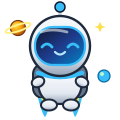<br/><sub>Juggles orbiting planets</sub> | <br/><sub>Jetpack flight around planets</sub> |
| 4 | **🦉 Ancient Scroll Owl**<br/>`wise-owl` | <br/><sub>Dozes off & pops sleep bubble</sub> | <br/><sub>Writes calligraphy with feather quill</sub> | <br/><sub>Delivers scrolls over misty peaks</sub> |
| 5 | **🌙 Moonlight Witch**<br/>`moon-witch` | <br/><sub>Spell backfires into green frog</sub> | <br/><sub>Stirs glowing magic cauldron</sub> | <br/><sub>Broomstick flight past crescent moon</sub> |
| 6 | **🦊 Chibi Kitsune**<br/>`fox-chibi` | <br/><sub>Transforms tofu into leaf</sub> | 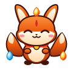<br/><sub>Spins mystical foxfire orbs</sub> | 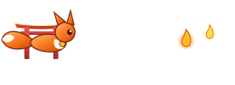<br/><sub>Dashes through Torii gates & lanterns</sub> |
| 7 | **🌸 Sakura Mochi Bunny**<br/>`sakura-bunny` | <br/><sub>Munches Dango & bursts hearts</sub> | <br/><sub>Pounds Mochi with wooden mallet</sub> | <br/><sub>Hops through cherry blossom woods</sub> |
| 8 | **🦈 Ocean Shark**<br/>`ocean-shark` | <br/><sub>Blows rubber ducky bubble</sub> | <br/><sub>Files its sharp teeth</sub> | <br/><sub>Slices waves & breaches high</sub> |
| 9 | **♟ Gangster Pawn**<br/>`gangster-pawn` | <br/><sub>Cigar misfires & tosses away</sub> | <br/><sub>Flips gold coin & fans dollar bills</sub> | <br/><sub>Rook charges → Promotes to Queen</sub> |
| 10 | **❄️ Glacier Penguin**<br/>`ice-penguin` | <br/><sub>Ice cream brain-freeze</sub> | 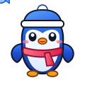<br/><sub>Juggles 3 silver fish</sub> | <br/><sub>Belly-slides across Arctic icebergs</sub> |
| 11 | **🤖 Minimalist AI Bot**<br/>`ai-robot` | <br/><sub>404 glitch & self-taps head</sub> | <br/><sub>Types on hologram keyboard</sub> | <br/><sub>Hoverboards through hologram gates</sub> |
| 12 | **🐾 Midnight Cat**<br/>`black-cat` | <br/><sub>Pounces on red laser dot</sub> | <br/><sub>Bats unraveling red yarn ball</sub> | <br/><sub>Leaps across moonlit rooftops</sub> |
| 13 | **⛄ Christmas Snowman**<br/>`noel-snowman` | <br/><sub>Unboxes reindeer antlers</sub> | <br/><sub>Writes wish list with candy cane</sub> | <br/><sub>Rides reindeer sleigh over pines</sub> |
| 14 | **🦁 Lunar New Year Lion**<br/>`tet-lion` | <br/><sub>Unfurls lucky scroll & firecrackers</sub> | <br/><sub>Dances to festive drumbeats</sub> | <br/><sub>Leaps plum-blossom poles</sub> |
| 15 | **🐱‍💻 Hacker Code Cat**<br/>`code-cat` | <br/><sub>ERROR → smashes laptop & grabs new</sub> | <br/><sub>Codes furiously on glowing screen</sub> | <br/><sub>Surfs mouse cursor catching bugs</sub> |
| 16 | **🗡️ 8-Bit Pixel Knight**<br/>`pixel-knight` | <br/><sub>Opens chest to tiny +1 EXP</sub> | <br/><sub>Forges glowing sword on anvil</sub> | <br/><sub>Jumps pipes & hits coin blocks</sub> |
| 17 | **🐋 Sunset Cloud Whale**<br/>`cloud-whale` | <br/><sub>Spouts rainbow & swallow perches</sub> | <br/><sub>Sings notes & cloud bubbles</sub> | <br/><sub>Swims past sunset floating islands</sub> |

---

## 🚀 1-Click Installation & Usage (Windows)

> **Zero external dependencies!** No Node.js or `npm install` required — the installer automatically runs using Antigravity's built-in Electron binary.

### 1. Install
1. Clone or download this repository as a ZIP:
   ```bash
   git clone https://github.com/DatNguyen0909/antigravity-custom-theme.git
   ```
2. Close **Antigravity** (or reload the window after installing).
3. Double-click **`install.bat`**.
   - Automatically creates a safe backup (`app.asar.bak`) inside `%LOCALAPPDATA%\Programs\antigravity\resources\`, builds `clean_bundle.js`, and patches `app.asar` with verified 4-byte header alignment and SHA-256 integrity recalculation.
4. Launch **Antigravity** (or press `Ctrl + Shift + P` → `Developer: Reload Window`).
5. Open **Settings (⚙️) → Custom theme** (right below `Appearance`) to choose your mascot, switch **EN / VI**, adjust background dimming, or set a custom wallpaper!

### 2. After Antigravity Auto-Updates
Whenever Antigravity updates to a newer version, its updater replaces `app.asar`. Simply **double-click `install.bat` again** (~2 seconds) — all your saved theme preferences remain 100% intact.

### 3. Uninstall / Restore Default
- **Instant in-app toggle**: Open **Settings → Custom theme** and switch **OFF** to immediately revert to the native interface without restarting.
- **Full unpatch**: Double-click **`uninstall.bat`** to restore the original `app.asar.bak`.

---

## 🏗️ Project Architecture (MVVM)

```text
antigravity-custom-theme/
├── index.html                      # Interactive Live Web Simulator & Gallery (EN / VI)
├── README.md                       # Documentation (English)
├── README.vi.md                    # Documentation (Vietnamese / Tiếng Việt)
├── stickers/                       # 17 mascot folders, 3 animated SVG states each
│   ├── jade-dragon/                # idle.svg | action.svg | typing.svg
│   ├── pixel-knight/               # idle.svg | action.svg | typing.svg
│   ├── cloud-whale/                # idle.svg | action.svg | typing.svg
│   └── ... (17 theme folders)
├── src/
│   ├── models/                     # [MODEL] Single Source of Truth (EN & VI metadata)
│   │   ├── themes.js               # 17 theme definitions (colors, localized text, FX)
│   │   ├── backgrounds.js          # Dark & Light gradients + frosted sidebar palettes
│   │   └── decor.js                # Background SVG scenery & ambient particle configs
│   ├── services/                   # [SERVICE] Persistence & runtime environment
│   │   ├── storageService.js       # Syncs localStorage + Electron disk storage.json
│   │   └── environmentService.js   # Light/Dark detection, portal filtering, SVG reset
│   ├── viewmodels/                 # [VIEWMODEL] Reactive state & user commands
│   │   └── themeViewModel.js       # State store, EN/VI language toggle, typing timers
│   ├── views/                      # [VIEW] Decoupled DOM renderers & stylesheets
│   │   ├── styles/
│   │   │   ├── base.css            # Background, overlay, sidebar, bubbles, composer
│   │   │   ├── mascots.css         # Keyframe animations for all 17 mascots
│   │   │   └── settings.css        # Settings -> Custom Theme modal UI
│   │   ├── backgroundView.js       # Renders #ag-custom-bg, #ag-custom-overlay, #ag-custom-decor
│   │   ├── chatView.js             # Renders chat bubbles, input stickers, typing particles
│   │   └── settingsView.js         # Hooks Custom theme tab & bilingual picker overlay
│   └── app.js                      # Bootstrapper (MVVM subscriptions, observers, tick)
├── build_bundle.js                 # Auto-discovers stickers/ + compiles src/ -> clean_bundle.js
├── repack_asar.js                  # Safe ASAR patcher with alignment & integrity verification
├── install.bat                     # 1-click build & install script
└── uninstall.bat                   # 1-click restore from app.asar.bak
```

---

## 🛠️ How to Add a New Theme (3 Easy Steps)

Thanks to the MVVM structure and automatic folder discovery in `build_bundle.js`, adding a 18th mascot is effortless:

1. Create `stickers/<theme-id>/` containing `idle.svg` (`120×120`), `typing.svg` (`120×120`), and `action.svg` (`260×95`).
2. Add `<theme-id>` entries to `src/models/themes.js`, `src/models/backgrounds.js`, `src/models/decor.js`, and its CSS rules in `src/views/styles/mascots.css`.
3. Run `install.bat` — the bundler automatically embeds the new folder and deploys it into Antigravity!

---

## 📄 License

Released under the **MIT License** — free to use, customize, and contribute new mascots!
