<div align="center">

[](./README.md)
[-dc2626?style=for-the-badge)](./README.vi.md)

# ✨ Antigravity Custom Theme Engine (v7 MVVM)

**Bộ giao diện Chibi chuyển động toàn diện dành cho Google Antigravity Desktop Client**

[](#%EF%B8%8F-b%E1%BB%99-s%C6%B0u-t%E1%BA%ADp-17-ch%E1%BB%A7-%C4%91%E1%BB%81-xem-tr%E1%BB%B1c-ti%E1%BA%BFp)
[](#%EF%B8%8F-b%E1%BB%99-s%C6%B0u-t%E1%BA%ADp-17-ch%E1%BB%A7-%C4%91%E1%BB%81-xem-tr%E1%BB%B1c-ti%E1%BA%BFp)
[](#%EF%B8%8F-c%E1%BA%A5u-tr%C3%BAc-d%E1%BB%B1-%C3%A1n-ki%E1%BA%BFn-tr%C3%BAc-mvvm)
[](#-t%C3%ADnh-n%C4%83ng-n%E1%BB%95i-b%E1%BA%ADt)

<br />






<br />

👉 **[Mở bản Xem Trước Tương Tác Trực Tiếp (GitHub Pages — Tiếng Việt)](https://datnguyen0909.github.io/antigravity-custom-theme/?lang=vi)**  
*(Hoặc mở trực tiếp file `index.html` trên máy để thử gõ chat, rê chuột, đổi Anh/Việt và chuyển đổi cả 17 chủ đề ngay trên trình duyệt!)*

</div>

---

## 🌟 Tính năng nổi bật

- **🎭 Hệ thống chuyển động 4 tầng cho mỗi linh vật (51 file SVG thuần CSS, siêu nhẹ)**:
  1. **Tĩnh + Diễn cảnh tự động mỗi 15 giây (`idle.svg`)**: Đứng nhịp nhàng trên bong bóng chat; cứ mỗi 15 giây tự diễn một tình huống hài hước riêng (Mèo Code gặp `ERROR` đập laptop, Chốt gangster quẹt lửa xì gà hỏng quăng đi, Hiệp sĩ mở rương ra `+1 EXP` thất vọng, Cá voi phun cầu vồng...).
  2. **Hành động đặc trưng khi bạn đang gõ (`typing.svg`)**: Khi nhập tin nhắn, mỗi linh vật diễn đúng bản chất riêng (Cá mập mài răng, Mèo than vờn cuộn len, Thỏ giã bánh Mochi, Hiệp sĩ rèn kiếm trên đe, Rồng vờn ngọc...) kèm hạt hiệu ứng theo từng phím và bong bóng suy nghĩ khi dừng tay 1,5 giây.
  3. **Hoạt cảnh sân khấu ngang khi rê chuột (`action.svg`)**: Rê chuột vào bong bóng chat hoặc ô nhập sẽ mở ra cả một sân khấu ngang có bối cảnh đi kèm (cổng Torii, cọc Mai Hoa Thung, ống nước & gạch `?`, đảo nổi hoàng hôn, Sao Thổ...).
  4. **Cảnh nền sống động, Song ngữ Anh/Việt & Thích ứng Dark / Light**: Tích hợp trực tiếp vào **Settings → Custom theme** của Antigravity với nút đổi ngôn ngữ **EN / VI**, hỗ trợ đầy đủ cả chế độ **Dark** và **Light**, thanh kéo chỉnh độ tối nền, tải ảnh nền cá nhân và lưu cứng cấu hình trên ổ đĩa qua Electron Storage.

---

## 🖼️ Bộ sưu tập 17 Chủ đề (Xem trực tiếp)

> 💡 Các ảnh bên dưới là **SVG chuyển động trực tiếp** từ thư mục `stickers/` — nếu đợi đủ nhịp 15s bạn sẽ thấy từng bé tự diễn trò ngay trong bảng này!

| # | Chủ đề | Tĩnh + Tự diễn mỗi 15s | Khi bạn đang gõ | Hoạt cảnh sân khấu khi rê chuột |
|:-:|:---|:---:|:---:|:---:|
| 1 | **🐉 Rồng ngọc**<br/>`jade-dragon` | <br/><sub>Hắt xì lửa ngọc</sub> | <br/><sub>Uốn lượn vờn minh châu</sub> | <br/><sub>Bay lượn xuyên mây lớn & mây nhỏ</sub> |
| 2 | **🔥 Phượng hoàng lửa**<br/>`fire-phoenix` | <br/><sub>Ấp trứng nở gà con</sub> | <br/><sub>Vỗ cánh vẽ cổ ngữ lửa</sub> | <br/><sub>Sải cánh bay qua mây lửa & thái dương</sub> |
| 3 | **🚀 Phi hành gia**<br/>`space-astronaut` | <br/><sub>UFO hút Sao Thổ</sub> | <br/><sub>Tung hứng hành tinh</sub> | <br/><sub>Bật Jetpack bay quanh các hành tinh</sub> |
| 4 | **🦉 Cú cổ thư**<br/>`wise-owl` | <br/><sub>Ngủ gật nổ bóng mũi</sub> | <br/><sub>Viết bút lông lên cổ thư</sub> | <br/><sub>Bay đưa mật thư qua đỉnh núi cổ phong</sub> |
| 5 | **🌙 Phù thủy ánh trăng**<br/>`moon-witch` | <br/><sub>Phép lỗi hóa ếch xanh</sub> | <br/><sub>Khuấy vạc phép thuật</sub> | <br/><sub>Cưỡi chổi bay qua trăng khuyết & tháp cổ</sub> |
| 6 | **🦊 Hồ ly chibi**<br/>`fox-chibi` | <br/><sub>Hóa đậu phụ thành lá</sub> | <br/><sub>Xoay cầu lửa hồ ly</sub> | 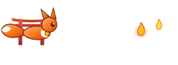<br/><sub>Phóng qua cổng Torii & đèn lồng</sub> |
| 7 | **🌸 Thỏ ngọc anh đào**<br/>`sakura-bunny` | <br/><sub>Ăn bánh Dango bắn tim</sub> | <br/><sub>Cầm chày giã bánh Mochi</sub> | <br/><sub>Nhảy lò cò qua rừng hoa anh đào</sub> |
| 8 | **🦈 Cá mập đại dương**<br/>`ocean-shark` | <br/><sub>Thổi bóng vịt vàng</sub> | <br/><sub>Cầm giũa mài hàm răng</sub> | <br/><sub>Vây cá rẽ sóng rồi phóng vọt lên</sub> |
| 9 | **♟ Chốt gangster**<br/>`gangster-pawn` | <br/><sub>Quẹt xì gà hỏng quăng đi</sub> | <br/><sub>Tung xu vàng & quạt đô la</sub> | <br/><sub>Xe cầm chùy tới → Chốt hóa Hậu rút súng</sub> |
| 10 | **❄️ Cánh cụt băng tuyết**<br/>`ice-penguin` | <br/><sub>Ăn kem đóng băng não</sub> | <br/><sub>Tung hứng 3 chú cá bạc</sub> | <br/><sub>Trượt bụng & nhảy qua tảng băng nổi</sub> |
| 11 | **🤖 Robot AI tối giản**<br/>`ai-robot` | <br/><sub>Lỗi 404 tự vỗ đầu sửa</sub> | <br/><sub>Gõ bàn phím Hologram</sub> | <br/><sub>Lướt ván từ trường qua cổng Hologram</sub> |
| 12 | **🐾 Mèo than**<br/>`black-cat` | <br/><sub>Đuổi vồ chấm đèn Laser</sub> | <br/><sub>Vờn cuộn len đỏ bung sợi</sub> | <br/><sub>Nhảy trên mái nhà đêm trăng</sub> |
| 13 | **⛄ Người tuyết Noel**<br/>`noel-snowman` | <br/><sub>Mở quà hóa sừng tuần lộc</sub> | <br/><sub>Viết điều ước bằng kẹo gậy</sub> | <br/><sub>Cưỡi xe tuần lộc phát quà rừng thông</sub> |
| 14 | **🦁 Kỳ Lân Múa Tết**<br/>`tet-lion` | <br/><sub>Nhả liễn Lộc & nổ pháo</sub> | <br/><sub>Múa đầu theo nhịp trống</sub> | <br/><sub>Nhảy cọc Mai Hoa Thung hái Lộc</sub> |
| 15 | **🐱‍💻 Mèo Code dạo**<br/>`code-cat` | <br/><sub>ERROR đập laptop lấy máy mới</sub> | <br/><sub>Gõ code cuộn màn hình</sub> | <br/><sub>Cưỡi con trỏ chuột đi vợt bug</sub> |
| 16 | **🗡️ Pixel Hiệp Sĩ 8-bit**<br/>`pixel-knight` | <br/><sub>Mở rương ra +1 EXP xịu mặt</sub> | <br/><sub>Đập búa rèn kiếm nung đỏ</sub> | <br/><sub>Nhảy qua ống nước & cụng gạch rơi xu</sub> |
| 17 | **🐋 Cá Voi Mây**<br/>`cloud-whale` | <br/><sub>Phun cầu vồng & chim én đậu</sub> | <br/><sub>Hát nốt nhạc & bong bóng mây</sub> | <br/><sub>Bơi giữa đảo nổi hoàng hôn tạo mây</sub> |

---

## 🚀 Hướng dẫn Cài đặt & Sử dụng (Windows — 1 Click)

> **Không cần cài đặt Node.js hay `npm install`!** Bộ cài tự động tận dụng nhân Electron có sẵn của Antigravity.

### 1. Cài đặt (Install)
1. Clone hoặc tải ZIP dự án này về máy:
   ```bash
   git clone https://github.com/DatNguyen0909/antigravity-custom-theme.git
   ```
2. Đóng ứng dụng **Antigravity** (hoặc cài xong rồi Reload cũng được).
3. Nhấp đúp chạy file **`install.bat`**.
   - Script sẽ tự động tạo bản sao lưu gốc `app.asar.bak` an toàn tại `%LOCALAPPDATA%\Programs\antigravity\resources\`, biên dịch `clean_bundle.js` và đóng gói vào `app.asar`.
4. Mở lại **Antigravity** (hoặc nhấn `Ctrl + Shift + P` → `Developer: Reload Window`).
5. Vào **Settings (⚙️) → Custom theme** (nằm ngay dưới mục `Appearance`) để chọn linh vật, chuyển đổi ngôn ngữ **VI / EN**, chỉnh độ tối nền hoặc tải ảnh nền riêng!

### 2. Khi Antigravity tự động Update lên phiên bản mới
Mỗi khi Antigravity cập nhật phiên bản mới, bộ cài của hãng sẽ ghi đè lại `app.asar` gốc. Bạn chỉ cần **nhấp đúp lại `install.bat`** (mất ~2 giây, mọi cấu hình chủ đề bạn đã chọn trước đó vẫn được giữ nguyên 100%).

### 3. Gỡ cài đặt về mặc định (Uninstall)
- Cách nhanh trong ứng dụng: Vào **Settings → Custom theme** và gạt công tắc **OFF** để về giao diện mặc định ngay lập tức mà không cần khởi động lại.
- Gỡ hoàn toàn khỏi `app.asar`: Nhấp đúp chạy file **`uninstall.bat`** để khôi phục bản `app.asar.bak` nguyên bản.

---

## 🏗️ Cấu trúc dự án (Kiến trúc MVVM)

```text
antigravity-custom-theme/
├── index.html                      # Trang Web xem trước tương tác trực tiếp (EN / VI)
├── README.md                       # Tài liệu Tiếng Anh (Mặc định trên GitHub)
├── README.vi.md                    # Tài liệu Tiếng Việt
├── stickers/                       # 17 thư mục linh vật, mỗi thư mục gồm 3 trạng thái SVG
│   ├── jade-dragon/                # idle.svg | action.svg | typing.svg
│   ├── pixel-knight/               # idle.svg | action.svg | typing.svg
│   ├── cloud-whale/                # idle.svg | action.svg | typing.svg
│   └── ... (17 thư mục chủ đề)
├── src/
│   ├── models/                     # [MODEL] Dữ liệu thuần (Single Source of Truth - VI & EN)
│   │   ├── themes.js               # Khai báo 17 chủ đề (màu, tên Anh/Việt, hoverBursts, typingFx)
│   │   ├── backgrounds.js          # Bảng màu nền & Sidebar kính mờ (Dark / Light)
│   │   └── decor.js                # Họa tiết nền SVG & cấu hình hạt bay DECOR
│   ├── services/                   # [SERVICE] Lưu trữ & môi trường
│   │   ├── storageService.js       # Đồng bộ localStorage + Electron storage.json trên ổ đĩa
│   │   └── environmentService.js   # Nhận diện Light/Dark mode, lọc portal/tooltip, reset SVG
│   ├── viewmodels/                 # [VIEWMODEL] State & điều phối logic phản ứng
│   │   └── themeViewModel.js       # Quản lý config, ngôn ngữ EN/VI, trạng thái gõ phím
│   ├── views/                      # [VIEW] Giao diện DOM & CSS tách biệt
│   │   ├── styles/
│   │   │   ├── base.css            # Nền, overlay, sidebar, editor, bong bóng chat, ô nhập
│   │   │   ├── mascots.css         # Animation idle, hover stage & hiệu ứng gõ của 17 linh vật
│   │   │   └── settings.css        # Giao diện bảng Settings Custom Theme
│   │   ├── backgroundView.js       # Render #ag-custom-bg, #ag-custom-overlay, #ag-custom-decor
│   │   ├── chatView.js             # Render bong bóng chat, ô nhập, sticker, hạt gõ phím
│   │   └── settingsView.js         # Hook tab Custom theme & bảng chọn chủ đề song ngữ
│   └── app.js                      # Điểm khởi chạy (MVVM subscription, MutationObserver, tick)
├── build_bundle.js                 # Trình đóng gói tự động src/ + stickers/ -> clean_bundle.js
├── repack_asar.js                  # Đóng gói an toàn vào %LOCALAPPDATA%\Programs\antigravity\resources\app.asar
├── install.bat                     # Chạy 1 click để build & cài đặt theme
└── uninstall.bat                   # Khôi phục app.asar gốc từ app.asar.bak
```

---

## 🛠️ Cách tự thêm một Chủ đề mới (Chỉ 3 bước)

Nhờ cấu trúc MVVM và cơ chế quét thư mục tự động của `build_bundle.js`, việc thêm chủ đề thứ 18 trở đi cực kỳ đơn giản:

1. Tạo thư mục mới `stickers/<ten-chu-de>/` gồm 3 file: `idle.svg` (`120×120`), `typing.svg` (`120×120`) và `action.svg` (`260×95`).
2. Thêm cấu hình màu & hiệu ứng của `<ten-chu-de>` vào `src/models/themes.js`, `src/models/backgrounds.js`, `src/models/decor.js` và animation vào `src/views/styles/mascots.css`.
3. Chạy `install.bat` — trình đóng gói sẽ tự động nhận diện thư mục mới và nạp vào Antigravity!

---

## 📄 Giấy phép (License)

Phát hành theo giấy phép **MIT License** — tự do sử dụng, tùy biến và đóng góp thêm linh vật mới!
